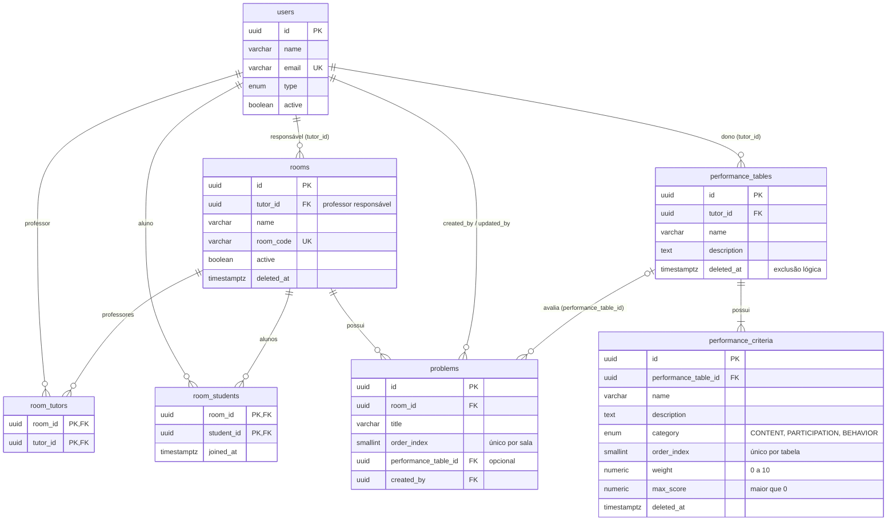

# Diagrama entidade-relacionamento

Reflete o esquema gerado pelas migrations até `ExtendPerformanceTablesAndLinkProblems`.

## Regras que o esquema garante

- Uma tabela de desempenho pertence a um professor e tem ao menos um critério, na mesma transação.
- Critérios não repetem `order_index` dentro da mesma tabela (`uq_performance_criteria_table_order`).
- `problems.performance_table_id` é opcional e usa `ON DELETE RESTRICT`: a exclusão da tabela é lógica (`deleted_at`) e ela continua válida nos problemas que já a usam.
- `rooms.tutor_id` passa a significar professor responsável; o acesso de todos os professores da sala vem de `room_tutors`.
